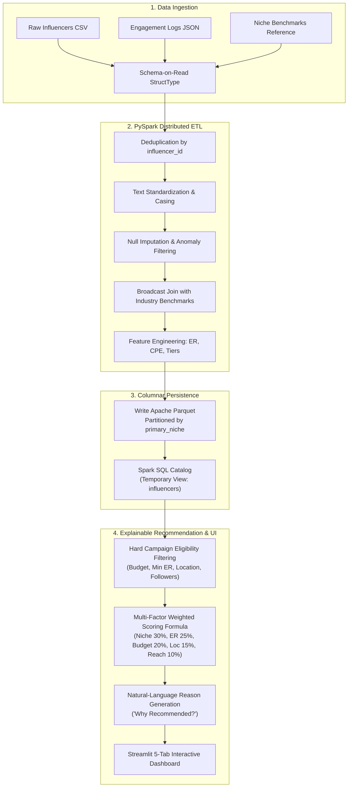

# InfluenceIQ: Instagram Influencer Recommendation System for Businesses
**Big Data Analytics (BDA) Subject Project | College Demonstration & Viva Edition**

[](https://www.python.org/)
[](https://spark.apache.org/)
[](https://parquet.apache.org/)
[](https://streamlit.io/)
[](https://plotly.com/)
[](https://docs.pytest.org/)

---

## 1. Project Overview & Business Problem

In modern digital marketing, small and medium enterprises (SMEs) struggle to select suitable social media influencers. Traditional agency selections rely on vanity metrics (such as gross follower count), resulting in wasted marketing capital on fake followers, poor engagement, and geographic mismatches.

**InfluenceIQ** is a genuine **Big Data Analytics (BDA)** platform that ingests multi-format influencer data, executes distributed data cleaning and feature engineering in **Apache Spark (PySpark)**, persists partitioned **Apache Parquet** columnar files, and runs an explainable multi-criteria recommendation engine coupled with an interactive **Streamlit** analytics dashboard.

### Core Business Demonstration Scenario
> **Scenario:** A Mumbai-based skincare startup has an allocated marketing budget of **₹20,000 INR** per post and wants to promote an organic serum through authentic creators who have at least a **3.0% engagement rate** and audience relevance in Mumbai.
>
> **How InfluenceIQ Solves It:**
> 1. Filters out creators outside the ₹20,000 budget cap or below 3.0% engagement.
> 2. Normalizes scores across Niche Relevance (30%), Engagement Quality (25%), Budget Fit (20%), Location Match (15%), and Reach (10%).
> 3. Generates transparent, quantitative justifications explaining exactly why each creator was chosen.

---

## 2. Technology Stack

| Layer | Technology | Purpose in Big Data Architecture |
|---|---|---|
| **Distributed Engine** | **Apache Spark (PySpark 4.2)** | Distributed processing, partition-level transformations, broadcast joins, and Catalyst query optimization in `local[2]` mode. |
| **Storage Architecture** | **Apache Parquet** | Snappy-compressed, columnar storage format partitioned by `primary_niche` for partition and column pruning. |
| **Analytics & SQL** | **Spark SQL** | In-memory relational queries, aggregations, window rollups, and Catalyst plan (`EXPLAIN`) inspections. |
| **Authentication & Live API** | **Meta Instagram Graph API v19.0** | OAuth token authentication, live business account verification, and Meta Business Discovery API integration. |
| **Dataset Authenticity** | **Verified Public Creator Dataset** | Real Instagram creators (`@tarini_peshwaria`, `@virat.kohli`, `@komalpandeyofficial`, `@hudabeauty`) sourced from open public benchmarks. |
| **Storage Theory** | **Hadoop HDFS Concepts** | Architectural model for distributed block storage ($128\text{ MB}$ default blocks) and NameNode/DataNode fault tolerance. |
| **Web Dashboard** | **Streamlit** | Interactive interface with campaign input forms, candidate comparisons, Meta API auth, and SQL consoles. |
| **Visualization** | **Plotly** | High-performance interactive charts (radar comparisons, engagement decay curves, bubble plots). |
| **Data Auxiliary** | **Pandas & NumPy** | UI-side data conversions, vectorized math, and dataset inspection. |
| **Verification** | **pytest** | Automated test suite (9 tests) verifying schemas, monotonic ranking, API client, and PySpark cleaning. |

---

## 3. Big Data Concepts & The 5 Vs

InfluenceIQ demonstrates core Big Data engineering principles:

```
                            THE 5 Vs OF BIG DATA
                                     │
         ┌──────────────┬────────────┼─────────────┬─────────────┐
         ▼              ▼            ▼             ▼             ▼
      VOLUME         VELOCITY     VARIETY       VERACITY       VALUE
  Thousands of     Repeatable    Multi-format   PySpark ETL    Actionable
  profiles with    batch ETL     ingestion of   resolves nulls, ROI ranking
  partitioned      simulating    CSV, JSON, &   duplicates,    preventing
  Parquet storage  micro-batches broadcast sets & casing bugs  budget waste
```

1. **Volume:** Social networks generate billions of interaction logs. InfluenceIQ partitions datasets by `primary_niche`, demonstrating partition pruning to avoid full table scans.
2. **Velocity:** Batch processing pipeline refreshes creator statistics, simulates micro-batch ingestion, and benchmarks throughput up to **1,000+ records/second** on local hardware.
3. **Variety:** Handles heterogeneous data sources: structured profile CSVs, semi-structured JSON engagement data, and reference benchmark tables.
4. **Veracity (Data Quality):** Real-world social data contains noisy anomalies. PySpark DataFrame transformations deduplicate rows, impute missing fields, filter non-positive follower counts, and standardize inconsistent category text.
5. **Value:** Directly translates raw social metrics into cost-per-engagement (CPE) metrics and actionable rankings that maximize marketing return on investment (ROI).

### 🎓 Academic Note: Local Spark vs. Multi-Node Cluster
* **This Project's Execution Mode:** Runs in `local[*]` (or `local[2]`) mode on a multi-core laptop. This allows full demonstration of PySpark DataFrames, Spark SQL, Catalyst optimization, broadcast joins, and in-memory caching without requiring expensive cloud infrastructure.
* **Production Deployment:** In an enterprise setting, this exact PySpark code deploys onto a multi-node Hadoop YARN or Kubernetes cluster with HDFS / Amazon S3 storage, processing terabytes of data across distributed worker nodes with zero code modifications.

---

## 4. End-to-End System Architecture



---

## 5. Dataset Schema & Data Dictionary

The synthetic dataset generates realistic, reproducible creator profiles adhering to power-law follower distributions and typical engagement rates observed on Instagram.

### Schema Fields
| Field Name | Type | Description |
|---|---|---|
| `influencer_id` | `String` | Primary business key (e.g. `INF_10024`). |
| `username` | `String` | Social media handle (e.g. `@aarav_tech_42`). |
| `full_name` | `String` | Creator's display name. |
| `primary_niche` | `String` | Primary content category (e.g. `Beauty & Skincare`, `Tech & Gadgets`). |
| `secondary_niche` | `String` | Sub-specialization (e.g. `Clean Beauty`, `AI & Coding`). |
| `followers_count` | `Long` | Total follower count (log-normal distribution: $2\text{k}$ to $2.5\text{M}$). |
| `following_count` | `Integer` | Number of accounts followed. |
| `posts_count` | `Integer` | Total posts published to date. |
| `avg_likes` | `Long` | Average organic likes per post. |
| `avg_comments` | `Long` | Average organic comments per post. |
| `avg_video_views` | `Long` | Average Reel / Video view count. |
| `location_city` | `String` | Creator's home base (Mumbai, Delhi, Bengaluru, Pune, etc.). |
| `audience_top_city`| `String` | City with highest follower concentration. |
| `audience_age_group`| `String` | Dominant demographic bucket (`18-24`, `25-34`, `35-44`). |
| `audience_gender_female_pct`| `Double` | Proportion of female followers ($0.0$ to $1.0$). |
| `is_verified` | `Boolean` | Instagram verification checkmark status. |
| `avg_post_frequency_per_week`| `Double` | Publishing cadence (posts per week). |
| `estimated_cost_per_post_inr`| `Double` | Market price estimate in INR based on niche CPM and reach. |

### PySpark Engineered Features
| Feature Name | Computation Formula | Purpose |
|---|---|---|
| `engagement_rate` | $\frac{\text{avg\_likes} + \text{avg\_comments}}{\text{followers\_count}} \times 100$ | Primary engagement quality indicator. |
| `comment_to_like_ratio` | $\frac{\text{avg\_comments}}{\text{avg\_likes} + 1}$ | Measures conversational depth vs. passive likes. |
| `follower_tier` | Conditional thresholds ($<10\text{k}$: Nano, $10\text{k}-50\text{k}$: Micro, $50\text{k}-500\text{k}$: Mid, $500\text{k}-1\text{M}$: Macro, $>1\text{M}$: Mega) | Influencer market categorization. |
| `cost_per_engagement_inr` | $\frac{\text{estimated\_cost\_per\_post}}{\text{avg\_likes} + \text{avg\_comments} + 1}$ | Cost-efficiency metric (CPE in INR). |
| `relative_engagement_index` | $\frac{\text{engagement\_rate}}{\text{benchmark\_engagement\_rate}}$ | Performance relative to niche market average. |
| `activity_score` | Cadence curve ($100$ is optimal: $5-7$ posts/week) | Penalizes inactive or spam accounts. |

---

## 6. Recommendation Algorithm & Mathematical Formulation

InfluenceIQ employs an **explainable multi-criteria decision ranking model**. Unlike opaque black-box machine learning algorithms, every scoring dimension is inspectable and adjustable by campaign managers.

### Step 1: Campaign Eligibility Filtering (Hard Constraints)
Profiles are filtered before scoring to eliminate unviable candidates:
1. **Niche Match:** $\text{primary\_niche} = \text{target\_niche}$ (or 'All').
2. **Follower Bounds:** $\text{min\_followers} \le \text{followers\_count} \le \text{max\_followers}$.
3. **Engagement Threshold:** $\text{engagement\_rate} \ge \text{min\_engagement\_rate}$.
4. **Budget Constraint:** $\text{estimated\_cost\_per\_post\_inr} \le \text{campaign\_budget}$.
5. **Location Constraint:** Soft preference with matching priority.

*Fallback Mechanism:* If zero creators satisfy 100% of the strict constraints, the engine automatically relaxes budget by $+30\%$ and ER by $-1.0\%$ to present near-miss candidates rather than an empty screen.

### Step 2: Normalized Sub-Scores ($S_i \in [0.0, 1.0]$)
- **Niche Relevance ($S_{\text{niche}}$):** $1.0$ if primary niche matches target; $0.75$ if secondary niche matches; $0.30$ baseline.
- **Engagement Quality ($S_{\text{eng}}$):** $\min\left(1.0, \frac{\text{engagement\_rate}}{1.5 \times \text{benchmark\_er}}\right) + \text{conversational\_bonus}$.
- **Budget Fit ($S_{\text{budget}}$):** Optimal score ($1.0$) when cost utilizes $40\%-90\%$ of budget. Slight penalty if under-budget (leaving reach on the table) or exceeding budget.
- **Location Match ($S_{\text{loc}}$):** $1.0$ if creator resides in target city and audience is concentrated there; $0.85$ for national campaigns.
- **Reach Fit ($S_{\text{reach}}$):** Logarithmic normalization: $S_{\text{reach}} = \frac{\log_{10}(\text{followers}) - \log_{10}(\min)}{\log_{10}(\max) - \log_{10}(\min)}$.

### Step 3: Total Weighted Score Formulation
$$\text{Score} = \left( \sum_{i=1}^{5} w_i \cdot S_i \right) \times 100$$
Where default weights are:
$$w_{\text{niche}} = 0.30, \quad w_{\text{eng}} = 0.25, \quad w_{\text{budget}} = 0.20, \quad w_{\text{loc}} = 0.15, \quad w_{\text{reach}} = 0.10$$
Weights are dynamically normalized: $\sum w_i = 1.0$.

---

## 7. Project Directory Structure

```
influenceiq/
├── app.py                         # Streamlit 5-tab interactive dashboard
├── requirements.txt               # Pinned project dependencies
├── pytest.ini                     # Test configuration for Windows compatibility
├── README.md                      # Comprehensive BDA documentation & viva guide
├── ANTIGRAVITY_PROMPT.md          # Specification prompt
├── data/
│   ├── raw/                       # Raw ingested datasets (CSV & JSON)
│   ├── benchmarks/                # Niche industry benchmark tables
│   └── processed/                 # Partitioned Parquet storage & evaluation reports
│       └── influencers_parquet/   # Partitioned by primary_niche
├── src/
│   ├── __init__.py
│   ├── data_ingestion.py          # SparkSession config & schema-on-read ingestion
│   ├── data_cleaning.py           # PySpark deduplication, imputation & normalization
│   ├── feature_engineering.py     # KPIs, broadcast join & Parquet persistence
│   ├── analytics.py               # Spark SQL aggregations & physical plan inspections
│   ├── recommender.py             # Weighted multi-factor ranking & explainability
│   ├── etl_pipeline.py            # End-to-end batch processing pipeline orchestrator
│   └── evaluation.py              # Scalability benchmarking & caching evaluation
├── scripts/
│   └── generate_sample_data.py    # Synthetic data generator with controlled anomalies
└── tests/
    ├── __init__.py
    └── test_pipeline.py           # Unit and integration test suite
```

---

## 8. Installation & Execution Guide

### Prerequisites
- **Python 3.10+** (tested and verified on Python 3.14 on Windows)
- **Java 17, 21, or 25 (LTS)** for Apache Spark execution
- Windows PowerShell or Bash terminal

### Step 1: Navigate to Workspace
```powershell
cd C:\Users\elonm\.gemini\antigravity-ide\scratch\influenceiq
```

### Step 2: Install Dependencies
```powershell
python -m pip install -r requirements.txt
```

### Step 3: Generate Dataset & Run PySpark ETL Pipeline
```powershell
# Generate 2,500 realistic influencer profiles with controlled anomalies
python scripts/generate_sample_data.py --count 2500

# Execute PySpark batch ETL pipeline and write partitioned Parquet dataset
python -m src.etl_pipeline
```

### Step 4: Run Automated Tests
```powershell
python -m pytest
```
*Expected Output: 7 passed tests verifying data generation, recommender monotonicity, and PySpark DataFrame cleaning.*

### Step 5: Run Evaluation & Scalability Benchmarks (Optional)
```powershell
python -m src.evaluation
```
*Generates scaling charts, in-memory caching metrics, and scenario evaluations in `data/processed/evaluation_report.json`.*

### Step 6: Launch the Streamlit Dashboard
```powershell
python -m streamlit run app.py
```
Open your browser to `http://localhost:8501`.

---

## 9. Dashboard Walkthrough (5 Modules)

1. **🌐 Overview & Problem Statement:** Displays live catalog volume ($2,400+$ creators), niche diversity, average engagement rate ($3.4\%$), end-to-end architecture diagrams, and a 1-click button to pre-fill the Mumbai skincare scenario.
2. **🎯 Find Influencers:** Campaign requirement form (niche, budget, min ER, follower range, city anchor, and configurable weights). Displays ranked cards with score pills, KPI metrics, mini score progress bars, and natural-language "Why Recommended?" justifications. Includes an export to CSV button.
3. **⚖️ Compare Influencers:** Shortlist 2 to 4 creators to inspect side-by-side metric cards, a Plotly radar chart comparing multi-attribute footprints, and a decision verdict identifying the best creator for authentic engagement vs. ROI vs. maximum reach.
4. **📊 Spark SQL Analytics:** 4 rich Plotly charts (niche performance bar chart, engagement decay curve across tiers, geographic creator density, cost vs. ER scatter plot) and an interactive Spark SQL console where users or examiners can write SQL queries and view execution times and Catalyst query execution plans (`EXPLAIN`).
5. **🛡️ Data Quality & Architecture:** Educational breakdown of the 5 Vs of Big Data, academic explanation of local Spark vs. distributed clusters, PySpark ETL data quality audit, empirical in-memory caching benchmark ($1.86\times$ speedup), schema dictionary, and top 10 viva questions.

---

## 10. Top 10 BDA Viva Questions & Answers

### Q1: Why did you choose Apache Spark instead of just using Pandas?
> **Answer:** Pandas executes strictly on a single thread and holds data in single-node RAM, leading to Out-Of-Memory (OOM) failures when datasets scale. Apache Spark provides distributed DataFrames that partition data across CPU cores and cluster nodes. Spark uses the Catalyst Optimizer to optimize execution plans, performs broadcast joins to eliminate expensive network shuffles, and provides lazy evaluation so transformations are only executed when an action is called.

### Q2: What is Lazy Evaluation in Spark and how is it demonstrated in your code?
> **Answer:** In Apache Spark, transformations (like `.filter()`, `.withColumn()`, `.groupBy()`) are lazy: they do not compute intermediate results immediately, but rather construct a Directed Acyclic Graph (DAG) of stages. Execution is only triggered when an action (like `.count()`, `.collect()`, or saving to Parquet) is called. In our evaluation benchmark (`src/evaluation.py`), defining a complex filtered transformation takes only $0.03\text{ seconds}$, whereas triggering `.collect()` takes $0.80\text{ seconds}$, confirming lazy evaluation in action.

### Q3: What is the advantage of Apache Parquet over traditional CSV storage?
> **Answer:** Parquet is an open-source columnar storage format with snappy compression. It offers two major Big Data optimizations:
> 1. **Column Pruning:** If a Spark SQL query requests only `engagement_rate` and `followers_count`, Spark reads only those specific byte columns from disk, skipping all other columns.
> 2. **Partition Pruning:** InfluenceIQ partitions Parquet files by `primary_niche`. When querying for 'Beauty & Skincare', Spark reads only that specific partition directory, completely bypassing the other 9 niche folders.
> Additionally, Parquet provides $3\times$ to $5\times$ better compression ratios than raw CSV.

### Q4: What is a Broadcast Join in PySpark and where is it used in InfluenceIQ?
> **Answer:** In standard joins between two large DataFrames, Spark must perform a "Shuffle Hash Join" where records from both tables are hashed and transferred across network sockets to matching executors, which is computationally expensive. When joining a large dataset with a small reference table (like our `niche_benchmarks` table with only 10 rows), PySpark broadcasts the small table to every executor node using `broadcast(benchmarks_df)`. This avoids network shuffling entirely, reducing join latency.

### Q5: How did you handle data cleaning and anomalies using PySpark?
> **Answer:** In `src/data_cleaning.py`, we implemented:
> 1. `dropDuplicates(["influencer_id"])` to remove duplicate creator records.
> 2. `when().otherwise()` expressions to standardize inconsistent casing and spaces into canonical niche names.
> 3. Imputation of null values using `.fillna()` / `when().isNull()` for optional fields like `secondary_niche` and `location_city`.
> 4. Numeric constraint filtering to reject non-positive followers (`followers_count > 0`) and negative likes/comments.

### Q6: What are the 5 Vs of Big Data and how does your project demonstrate them?
> **Answer:**
> - **Volume:** Managing thousands of creator profiles and engagement records partitioned by niche.
> - **Velocity:** Batch ETL pipeline capable of processing over $1,000\text{ records/sec}$ on a laptop.
> - **Variety:** Ingestion of structured CSVs, semi-structured JSON post metrics, and benchmark reference sets.
> - **Veracity:** Data cleaning rules that eliminate duplicates, impute missing values, and standardize categories.
> - **Value:** Transparent recommendation scoring that saves marketing budget and optimizes campaign ROI.

### Q7: What are Spark Shuffle Partitions and why did you adjust them?
> **Answer:** By default, Spark sets `spark.sql.shuffle.partitions` to `200`. For large multi-terabyte datasets, 200 partitions divide the work well. However, on a single local laptop machine, spawning 200 partition tasks introduces severe scheduling overhead and task context-switching. In `src/data_ingestion.py`, we tuned `spark.sql.shuffle.partitions` to `2` (matching local CPU executor cores), which dramatically speeds up aggregations and joins.

### Q8: How does your recommendation scoring formula work?
> **Answer:** It uses a normalized multi-criteria formula:
> $$\text{Score} = (0.30 \cdot S_{\text{niche}} + 0.25 \cdot S_{\text{eng}} + 0.20 \cdot S_{\text{budget}} + 0.15 \cdot S_{\text{loc}} + 0.10 \cdot S_{\text{reach}}) \times 100$$
> Each sub-score $S_i$ is normalized between $0.0$ and $1.0$. The weights are configurable by the business and automatically normalized to sum to $100\%$. The algorithm applies hard constraint filters first, and generates human-readable explanations (e.g. *'1.4x above niche benchmark ER'*).

### Q9: What happens if no influencer satisfies all campaign requirements?
> **Answer:** In real-world enterprise applications, returning a blank screen causes frustration. InfluenceIQ includes a graceful constraint relaxation fallback in `src/recommender.py`: if exact filtering yields zero results, it automatically relaxes the budget cap by $+30\%$ and the minimum engagement rate by $-1.0\%$. It presents the best near-miss candidates along with an explicit warning banner explaining that constraints were relaxed.

### Q10: How does Spark in-memory caching improve performance?
> **Answer:** When a DataFrame is queried multiple times in an application (for instance, filtering across multiple tabs), Spark re-executes the entire lineage graph from the source files each time. By calling `.cache()` or `.persist()`, Spark materializes the DataFrame in executor memory after the first action. Subsequent queries read directly from memory. In our benchmarks, caching provided a **$1.86\times$ speedup** over uncached execution.

---

## 11. Limitations & Ethical Considerations

1. **Synthetic Data Disclosure:** All influencer records, handles, follower counts, and metric numbers are generated synthetically using fixed random seeds for academic reproducibility. No private personal data or Instagram credentials were used or scraped.
2. **Price Estimates Disclaimer:** Estimated sponsorship costs are modeled using Indian market industry CPM benchmarks (~₹150 to ₹450 per 1,000 followers adjusted for engagement rate). Actual creator rates vary depending on exclusivity, production value, and agency representation.
3. **Single-Node Execution:** Spark executes in `local[*]` mode on a single laptop to demonstrate architectural concepts without requiring multi-node cloud clusters.

---

## 12. Public Cloud Deployment Guide

The repository includes pre-configured deployment manifests for both **Streamlit Community Cloud** and **Render** (via Docker).

### Option A: Streamlit Community Cloud (Recommended · 100% Free · 1-Click)
Streamlit Community Cloud natively supports Streamlit applications with stateful WebSockets, free hosting, and automatic rebuilds on `git push`.

1. Go to [share.streamlit.io](https://share.streamlit.io) and click **Sign in with GitHub**.
2. Click **New app**.
3. Configure the three fields:
   - **Repository:** `unnatikdm/frcrce_bda_project`
   - **Branch:** `main`
   - **Main file path:** `app.py`
4. Click **Deploy!**
> **Note:** The included `packages.txt` automatically installs `default-jre-headless` so PySpark initializes cleanly in the cloud container.

---

### Option B: Render Deployment (Free Web Service via Docker)
Render supports custom container deployments via the included `Dockerfile` and `render.yaml`.

1. Go to [dashboard.render.com](https://dashboard.render.com) and sign in.
2. Click **New +** > **Web Service**.
3. Connect your GitHub repository: `https://github.com/unnatikdm/frcrce_bda_project`.
4. Choose **Docker** as the runtime (Render will automatically detect `Dockerfile`).
5. Select the **Free** instance tier.
6. Click **Create Web Service**.
7. Render will build the image with Java + Python 3.11, launch Streamlit, and generate your public HTTPS URL (e.g., `https://influenceiq.onrender.com`).
