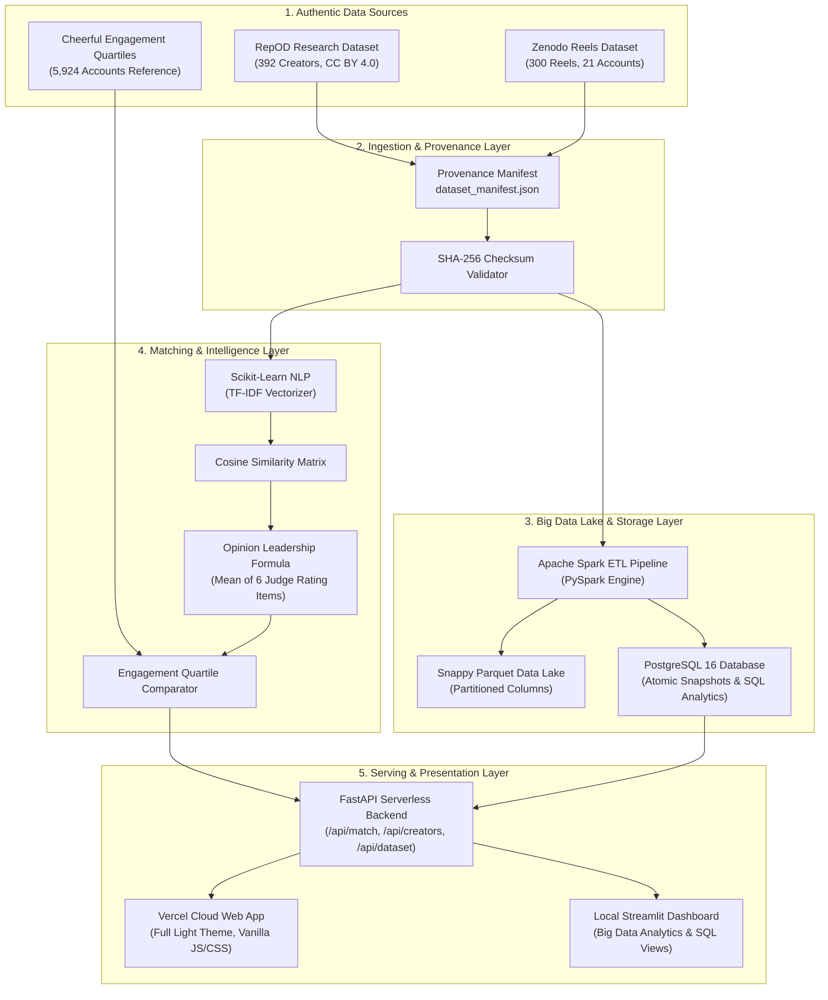

# System Architecture & Step-by-Step Data Flow

> A clear visual and narrative guide to how data flows through InfluenceMatch from raw files to live web recommendations.

---

## 1. High-Level Architecture Diagram

---

## 2. Step-by-Step Data Flow Explained

### Step 1: Ingestion & Integrity Validation
- **What happens**: The system downloads or reads authentic dataset files (`.ods` or `.xlsx`).
- **Integrity Check**:
  - The file's cryptographic hash (MD5 and SHA-256) is calculated.
  - If it matches the published repository checksum, it is converted into standardized JSON Lines format (`data/active/creators.jsonl`).
  - A provenance manifest (`data/active/dataset_manifest.json`) is generated recording the exact observation counts, non-null fields, and rights attestation.

---

### Step 2: Apache Spark ETL & Parquet Data Lake
- **What happens**: When running Big Data workloads, `python -m influencematch.pipeline` boots an Apache Spark session in local mode (`local[2]`).
- **Validation Rules Enforced by Spark**:
  1. Validates that the input file hash matches the provenance manifest.
  2. Confirms creator IDs are unique and non-empty.
  3. Checks that post records have valid references to parent creators.
- **Output**: Writes snappy-compressed columnar **Parquet** files into the data lake.
- **Why this matters**: In production, Parquet allows sub-second query performance even when scanning millions of creators.

---

### Step 3: PostgreSQL Database Snapshot
- **What happens**: `python -m influencematch.db` loads the verified dataset snapshot into PostgreSQL inside a single atomic transaction.
- **SQL Analytics Capabilities**:
  - Computes follower distribution percentiles (p25, median, p75, max).
  - Calculates niche category counts and coverage ratios.
  - Aggregates Reel views, comments, and ratings when post data is loaded.

---

### Step 4: NLP Matching & Recommendation Algorithms
When a user submits a campaign brief (for example: *"fitness and lifestyle creators"*):

1. **Eligibility Filtering**:
   - The engine checks hard constraints (e.g., minimum and maximum follower limits).
   - If an influencer falls outside the range, they are excluded immediately.
2. **Niche & Topic Analysis**:
   - For text bios and topics, **TF-IDF (Term Frequency-Inverse Document Frequency)** converts words into vector weights.
   - **Cosine Similarity** measures how closely the creator's content matches the campaign brief.
3. **Opinion Leadership Scoring (RepOD Dataset)**:
   - For RepOD research data, influencers are ranked by their empirical **Opinion Leadership score**.
   - This score is calculated as the exact arithmetic mean of six standardized judge ratings:
     $$\text{Score} = \frac{\sum \text{Observed Items}}{\text{Count of Items}}$$
   - **Transparent Rule**: If a creator has missing judge rating items, they are excluded rather than assigned a fake zero.

---

### Step 5: Serving APIs via FastAPI
The backend exposes clean, self-documenting REST endpoints:
- `GET /health`: Checks service status and data availability.
- `GET /dataset`: Returns active dataset provenance, license, and hash status.
- `GET /creators`: Retrieves paginated authentic creator records.
- `POST /match`: Executes the recommendation algorithm for a given brief and returns ranked creators with their complete calculation traces.
- `GET /docs`: Interactive Swagger documentation for developers.

---

### Step 6: Presentation (Cloud Web App & Local Dashboard)

#### Cloud Web App (Vercel)
- Hosted at `https://influencematch-zeta.vercel.app/`.
- Built with Vanilla HTML5, Vanilla CSS3 (Full Light Theme), and Vanilla JavaScript.
- Communicates directly with the FastAPI serverless functions.
- Provides real-time KPI metrics, category breakdown bars, quick brief presets, match cards, and a searchable creator explorer table.

#### Local Data Science Dashboard (Streamlit)
- Ran locally with `streamlit run src/influencematch/dashboard.py`.
- Designed for internal data science exploration, comparing PostgreSQL SQL summaries, viewing Spark timing benchmarks, and exporting full JSON recommendation traces.
